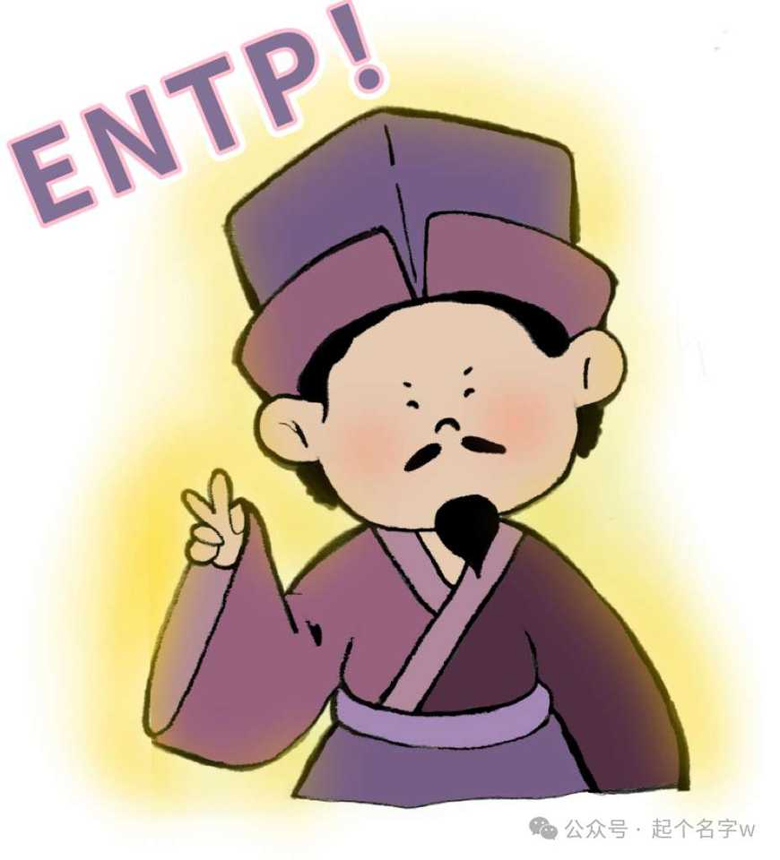
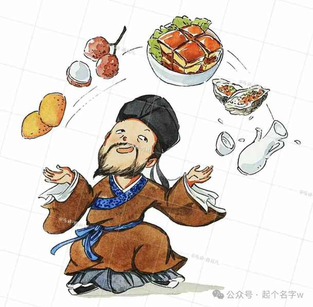

# 图引

最近，在上网冲浪的时候，你是否总能看到这样一个词：

MBTI

还有这样的热搜话题：

### 给 J 人一点小小的 P 人震撼

### I 人地狱不过如此

### 为 I 做 E，一秒都不能再多了！

或许你的生活中还发生过这样的对话：

“MBTI题库又更新啦！这次你测出来是什么？”

“哦哦哦！我是那个叫ES···”

打住！

现在大家都知道自己的MBTI了，但你有没有好奇过咱中国古人的MBTI呢？

比方说.....苏东坡！

其实，大名鼎鼎的东坡居士早就被MBTI学家贴上了大大的标签：

ENTP

你可能会感到疑惑，怎么就是ENTP了？

先别急，让我们先来看一些ENTP的“刻板印象”

提到ENTP，大部分人的第一印象大概是“灵活又跳脱，高傲又嘴欠”，经常惹得流泪猫猫头INFP委屈离场，气得天生表演家ESFP暴跳如雷，一整个惹人又爱又恨的乐子人。

那么我们的ENTP苏轼是怎么做的呢？

元丰六年十月十二日夜…念无与为乐者，遂至承天寺寻张怀民。怀民亦未寝，相与步于中庭。

> ---《记承天寺夜游》

月光洒满庭院，像一潭清水一样澄澈透明。院中竹子柏树枝叶摇摆，影子倒映在地上就好像水中荡漾的藻荇。可是这样静谧又安宁的夜晚漫步图，怎么仔细想象一下好像是苏轼把正要休息的怀民从床上拖了起来：

“睡了没有？来！一起散步！”

怀民：

简直是太欠了！

我们继续...

ENTP是天生的辩论家，几乎从不退缩。他们总是毫不犹豫地想要拒绝和推翻与自己不同的想法，并且自信满满又豪情壮志地宣传和证明自己的观念。

那么我们的苏轼又是怎么做的呢？

彼时还年轻的苏轼，在报考“制科”时候有作一文《贾谊论》，字里行间说贾谊应该先与汉文帝君臣搞好关系，“然后举天下而唯吾之所欲为，不过十年，可以得志”。他批评贾谊太过急功近利，得罪了一批老臣，以至于最终怀才不遇而死。

熙宁元年，王安石被神宗召见，担任参知政事，策划变革的“新法”。苏轼强烈反对：“国家之所以存亡者，在道德之深浅，在风俗之薄厚”。他以民为本，激烈又强硬地反抗着王安石的“以国为本”。

到这里，你是不是觉得一个ENTP的形象跃然眼前呢？

然而，有人要反驳了…

林语堂先生在《苏东坡传》中描写到，“苏东坡是一个元气淋漓富有生机的人”，“他过的快乐又无所畏惧”。

这么一个随心所欲的乐天派欢乐豆，怎么看怎么像ENFP阳光大狗狗呢？

笔者认为，两种观念都不无道理。今天，笔者想要从一个更本质的角度分析苏东坡老先生的人格特点，为大家提供一种更深刻的思考方式。那就是…

荣格八维

我们可以认为，MBTI是荣格八维的化简版。同时，我们也可以根据荣格八维反向推测MBTI类型。

那么到底什么是荣格八维呢？

荣格

荣格八维的概念来自于我的《心理类型》一书。我将人的认知功能划分为两个部分，一个是用于感知的功能（P），一个是用于决策的功能（J）。感知能力有两种倾向，一种是实感（S），另一种是直觉（N）。决策功能同样也划分为情感（F）和思维（T）。SNFT四种功能又各自划分为向外-E使用（通俗理解为更专注外界）和对内-I使用（通俗理解为专注自己），由此我们得到八种组合方式。

在分析苏轼之前，笔者认为大家需要对这八个维度分别都有什么特点有大致了解，所以总结了比较通俗易懂的解释。

## 感知

内倾感觉(Si)：专注自身获得的真实细节的人，喜欢调用自己的历史经验，比较保守传统。

外倾感觉(Se)：专注于外在存在的事物的人，对外界事物变化有敏锐的洞察力，喜欢新奇的感官体验和物质享受。

内倾直觉(Ni)：依赖自身洞察力的人，喜欢通过对现实世界的观察，总结抽象出共性，提炼自己的理论。

外倾直觉(Ne)：依赖外界信息产生直觉的人，富有联想力和创造力，思维跳脱又活跃，天马行空。

## 决策

内倾思维(Ti)：依赖自身理性思考做判断的人，擅长顺着一条基础原则进行深入推理，试图寻找背后的真理。

外倾思维(Te)：依赖外界多样的理性判断时，倾向于认为现有的标准化程序是存在合理性的，客观且务实，类比领导。

内倾情感(Fi)：依赖自身情感的人有着独立的价值观，欣赏并认可自己和身边事物，但遇到底层观念冲突时会奋起反抗。

外倾情感(Fe)：依赖外界感情的人会一定程度丧失自身情感独立性，会弱化自身情感需求以实现和环境的融洽。

每一种MBTI，其背后都有四种主要的荣格功能作为其心理动力学的主要支撑。

ENTP=Ne+Ti+Fe+Si

ENFP=Ne+Fi+Te+Si

我们可以看到两者间确实存在某些共性，所以存在争议也是有可能的。

笔者认为，苏轼的性格并不完全地偏向于某一方。用荣格八维分析，他的人格构成更像是Ne, Fi, Ti, Se。

以东坡诗词为主要线索，来看看笔者为什么这么认为吧~

Se

在生活上有点“小天赋”

无论是在度过天真烂漫童年的眉山，还是几经政治挫败后被贬到的徐州，黄州等地，苏轼仿佛总是有能力把生活过出“花儿”来，即便没有亲身经历，他也能把生活“看”出“花儿”来。在黄州，他养生健体，念佛，摸鱼，和高僧探讨梳头的讲究。君子近庖厨，东坡肘子，泡菜，鱼，手中美味层出不穷。

好竹连山觉笋香···尚废官家压酒囊。

> ---《初到黄州》

吃好喝好玩好，主打一个视听嗅味触的享受。

在徐州做官时，有一次苏轼谢雨途中经过一农村，写下：

簌簌衣巾落枣花，村南村北响缲车，

牛衣古柳卖黄瓜。

酒困路长惟欲睡，日高人渴漫思茶。

敲门试问野人家。

> ---《浣溪沙》

初夏时枣树开出的小花扑簌簌落在行人身上，缫丝的声音村南村北连成一片，还有一个农民在买黄瓜。而他也是酒后困倦，闲敲一户人家，讨点淡茶。几笔写实的意象，勾勒出一幅初夏乡间生活图。

体验生活，享受生活，Se值拉满！

## 体验生活 · 享受生活

Se值拉满！

Ne

天马行空，日行八里

体验生活（Se）是东坡的一种态度，却不是他的内核。要说到东坡的精神世界，就不得不提他的Ne了。

Ne的思维方式是向外发散的，由一个可能性生出更多可能性，巧妙又天马行空。

如果说客观的事物是死板而且静止的，那么苏轼就好像能用词创造出一种流动感来。客观事物在眼里动了起来，好像是有了哲理在，但却没有哲理的说教感，显得童趣又生动。

墙里秋千墙外道，墙外行人，

墙里佳人笑。

笑渐不闻声渐悄，多情却被无情恼。

> ---《蝶恋花· 春景》

墙里人不知墙外有人，墙外人听墙里人的笑声。在好奇她为什么笑得这么开心时，自己也被无端地勾起了许多联想。墙里墙外弯弯绕绕，心绪也是复杂又难以言说，终是多情恼人。

横看成岭侧成峰，远近高低各不同。

不识庐山真面目，只缘身在此山中。

> ---《题西林壁》

横看山岭连绵不绝，侧看却又高耸伫立，远近高低四个角度，每个角度都有独自的风景。

作者随身处山中，但思维却飘散到高处，以不同的视角观察同一个世界，便悟出写“只缘身在此山中”的哲理来。原来，要认识事物的真相与全貌，需得超越有限的范围，摆脱狭小的主观成见。

## 奇思妙想 · 偶尔哲理

不是Ne是什么！

Ti

豪情与失意共存者

前情回顾，Ti使用者思考问题时会采用一条基础性原则作为基点，保持思维的连贯和一致。

苏轼是一个接受了儒家正统思想的文人，建功立业是他根深蒂固的人生格言。

他的政治主张在二十岁就渐趋于成熟，而在反对变法的过程中，他一直坚守“致君尧舜上，再使风俗淳”的观念。他深知风俗和道德来之不易，变革不应操之过急。在朝廷上，他是少数几个敢于在王安石倡新法面前直言变法之不便的人。

我们都说，苏轼是有豪情的，而支撑他豪情的，正是他始终坚定的政治抱负。

老夫聊发少年狂···为报倾城随太守，亲射虎，看孙郎。

···持节云中，何日遣冯唐？

> ---《江城子· 密州出猎》

有笔头千字，胸中万卷。

> ---《沁园春·孤馆灯青》

一生豪情壮志，胸中有万壑，只为一信念的坚守。

然而，始终如一的坚守，却令他的失意更显悲凉。

孤馆灯青，野店鸡号，旅枕梦残。

> ---《沁园春·孤馆灯青》

孤零零的旅社灯光清冷，听倦了是野鸡悲鸣，客店枕头似乎还残留着昨夜冰冷梦境，凉意似乎浸透了骨髓。

政治上

坚持初心不动摇

我就是Ti王者

Fi

人生如逆旅，我亦是行人

如果说Se和Ne代表着苏轼如何感知和看待这个世界，Ti代表他在世俗中的坚守，那么Fi或许是他真正的人生内核。

Fi功能使用者有一个相当坚定的自我价值观，他清楚地知道自己想要什么，但同时又能清楚地分开主体与客体，其外界表现为，在人生仿佛已经于逆境中无法喘息的时候，总是可以超脱其中。

长恨此身非我有，何时忘却营营。

夜阑风静縠纹平。

小舟从此逝，江海寄余生。

> ---《临江仙·夜归临皋》

一个人的形体精神是天地自然所赋与，此身非人所自有，所以不要因为形体在世俗中经历的痛苦就思虑百端。不如驾起小船从此离开，将余生寄托在这江海上。

与Fe不同，Fi特质具有很强的独立性，它的内核是冷的，以至于有时会显得格外孤独：

照野弥弥浅浪，横空隐隐层霄。

障泥未解玉骢骄，我欲醉眠芳草。

可惜一溪风月，莫教踏碎琼瑶。

解鞍欹枕绿杨桥，杜宇一声春晓。

> ---《西江月·顷在黄州》

宿醉而归，披着月光走到一座小石桥上屈肘而眠。醒时已是破晓，流水铮铮。只因杜鹃声伴左右，这里疑似非尘世间。

虽然苏东坡的后半生一直在入世和出世（即寻找精神的完全超脱）之间一边寻求平衡一边寻求答案，但或许他已经寻到了最终答案：

心向自由却不避尘世喧嚣

莫听穿林打叶声，何妨吟啸且徐行。

竹杖芒鞋轻胜马，谁怕？一蓑烟雨任平生。

料峭春风吹酒醒，微冷，山头斜照却相迎。

回首向来萧瑟处，归去，也无风雨也无晴。

> ---《《定风波·莫听穿林打叶声》

管它是风是雨，都是来自世俗之物，既来之则安之！

世间万物都是虚幻的影，可依此消解执念所带来的苦闷，显得是格外乐观豁达。

内冷外热

坚守本心

我们Fi人是这样的

总的来说，Ne+Se的运用让苏轼像一个“乐天派”，而Ti+Fi又向我们揭示了他的豪放与沉郁，超脱与自由的一面。荣格八维从另一种分析视角向我们展现了一个有血有肉的苏东坡。

需要注意的是，无论是MBTI还是荣格八维，都只是一种理解东坡角度，苏轼更不是能被三两标签就可以定义的。一千个人心中，有一千个苏东坡！

时代在变化，无论是写词达意，还是在MBTI中寻找归属感，不同的自我阐释方式在不断变迁，但身为人类的精神力量却亘古不变。或许MBTI和荣格八维可以作为跨越古今历史长河的桥梁，让今天的我们与古人产生更强烈的共鸣。
