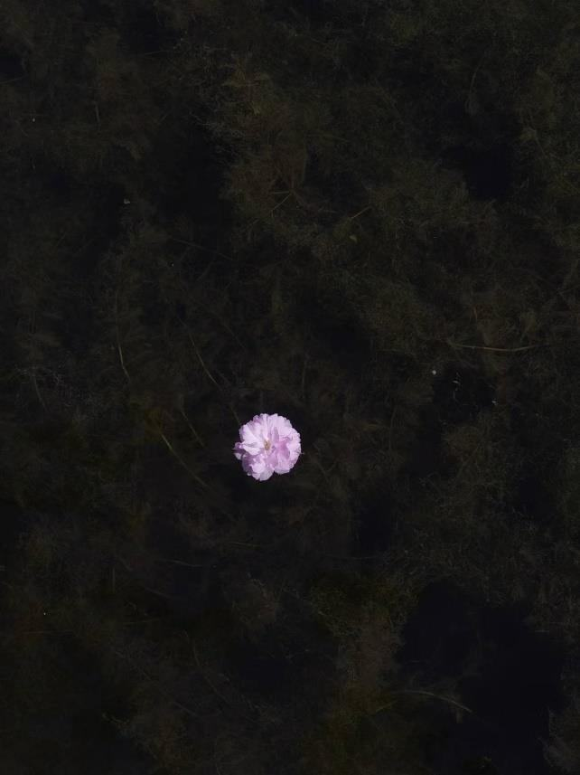
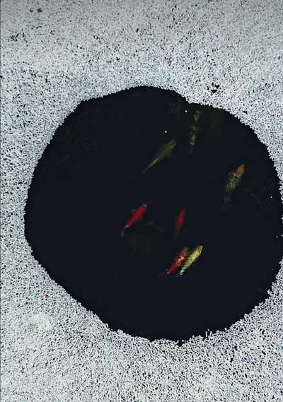

# 镜头

# 配词

> 酒罢歌馀兴未阑，小桥清水共盘桓。
> 波摇梅蕊当心白，风入罗衣贴体寒。
> 且莫思归去，须尽笙歌此夕欢。
> ——冯延巳《抛球乐·酒罢歌馀兴未阑》

# 随笔

两张照片摄于南京老山珍珠泉边。阴雨绵绵的春日，一朵海棠落在水中，寒风吹来，花影在清流里漂转；不远处的锦鲤又荡开水波，给寂静的池面添了一点生机。

清明时节，阴雨、寒风、落花与春暮叠在一起，容易让人想到沉重的往事。但儿童的笑声穿过树林，水中的鱼也打破了低沉的画面。生活总会在最细小的地方重新给人希望，正如词中由伤春转向“且莫思归去，须尽笙歌此夕欢”。

“波摇梅蕊当心白”尤其令人难忘。有人以为水波摇动的是树上梅花的倒影，但眼前所见也说明，花瓣聚在波心时，落花本身同样可以成为被水摇动的景物。词中的伤春与照片中的落花因此真正相接。
