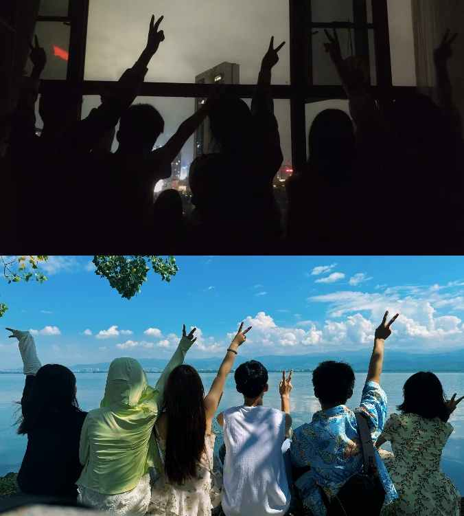
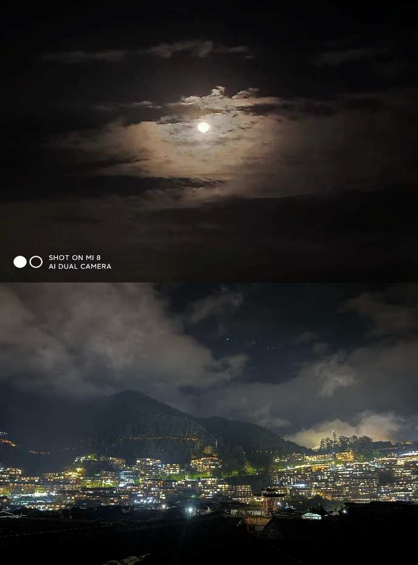

# 镜头

*拍摄信息：第一张摄于 2022 年 10 月 4 日，朋友家中；第二张摄于 2024 年 8 月 6 日，西昌邛海旁 · 手机拍摄*

# 配词

> 况有狂朋怪侣，遇当歌对酒竞留连。
> ——柳永《戚氏·晚秋天》

# 随笔

当时听老师讲起这句词，便十分有感触。柳永将自己少日宴饮时的朋友称作“狂朋怪侣”，何等豪放；此句也道尽了挚友相伴的酣畅与赤诚。

“狂”并非放浪，而是卸下伪装后的率真；“怪”并非乖戾，而是灵魂同频的默契。那些无需寒暄的相遇，那些歌以抒怀、酒以寄情的时光，恰是人间珍贵的烟火情长。我初中结识的朋友，大抵便是这样的“狂朋怪侣”。

初中时，我们常常聚在一起。课间闲聊日常、分享趣事，体育课自由活动时一起玩游戏，或是在少年时代留下无数小小的共同秘密。此刻回想，这些当时并不觉得特殊的瞬间，都成了记忆深处的光，是青春里最鲜活的注脚。

步入高中后，学业压力增大，空闲越来越少。高中三年里，我们只在高二国庆见过一面。那天大家坐在朋友家中，面朝窗外夜景，身边摆着喜欢的饮料和刚送到的晚餐，一起畅谈未来。夜色越深，离别也越近。我们缓慢地走出小区、走向地铁站，仍有说不完的话。途中有人哼起大家喜欢的歌，所有人便一起唱了起来。

“也但愿赴汤蹈火去走它一遍……”

高考结束后，沉重的压力突然轻了许多。我们一起走过邛海、昆明、瓦屋山与贵州，并在邛海旁并排坐下，依旧大胆畅谈未来。录取结果已经公布，大家即将踏上不同的道路，追逐各自也共同拥有的梦想。

如今身处大学，朋友分隔在不同城市。我也终于懂得，曾经随口一句“要一起出去玩吗”，慢慢变成了带着等待的“你回来了吗”。但即使大家都在为自己的生活奔波，线上仍保持联系，分享日常、抱怨疲惫，也畅想着下一次假期的相聚。

那些“歌对酒”的酣畅，化成日常里的相互扶持；那些“竞留连”的不舍，凝成岁月中温暖的牵挂。这般情谊无关功利，只凭真心。正是这些“狂朋怪侣”，让平淡生活有了亮色，也让追梦的路途不再孤单。
