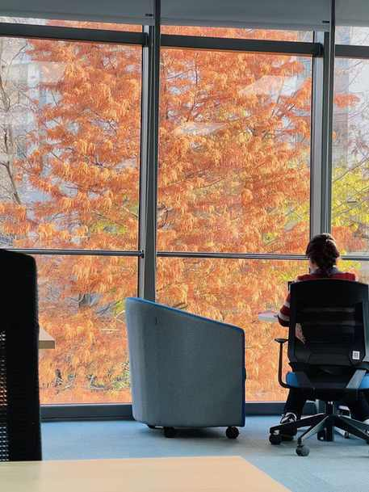
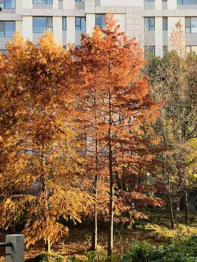

# 镜头

# 配词

> 窗外阑珊，案前思绪，一城金桂如何语？
> 西河斫树落人间，云移风渐蟾宫雨。
> 秋爽还来，夏虫将去，此间风景红黄处。
> 今朝唱遍素秋好，言何效古空思虑。
> ——自填《踏莎行》

# 创作手记

作这首词之前，我本想修改上一首匆忙填成的词，思索许久仍没有头绪。后来突然意识到，自己实在不能“借昔日的情强作笔下的词”，于是转而写下当时真实的状态，便有了“窗外阑珊，案前思绪，一城金桂如何语”。

我很喜欢桂花香，房间里的香薰与洗衣液也多是桂香调。大一时还买过一些瓶瓶罐罐，试图将秋天的香气封存。因此每逢金桂时节，心情总很愉快。填词前两天，一夜风雨打落了许多桂花，我害怕香气很快消失，便有了“用词留香”的念头。

我读了一些写花的词，仍不知道该怎样说桂香，只觉得它不同于其他花香，仿佛来自仙境。于是想到了月宫与吴刚。“西河斫树”借用李商隐“月中桂树高多少，试问西河斫树人”的想象，点出桂花仿佛从月宫飘落人间。风渐渐大了，花落在人的肩头发尾，便像一场来自蟾宫的雨。

下片前两句来自抬头时的满眼红黄。秋天清爽的空气驱散暑热与夏虫，也让心情舒展。既然上片已经思虑良久，此时若不爽快落笔，反倒丢了秋天的几分气韵，于是文不加点地写下结句。原稿的平仄与用字仍有不足，经课堂斧正后成为今天的版本。

最后一句写的正是我的创作态度：不会为赋新词强说愁，能写下来的只能是当时真正拥有的情绪。我不愿“借昔日之情赋笔下之词”，只愿诚实记录此刻的秋光。
