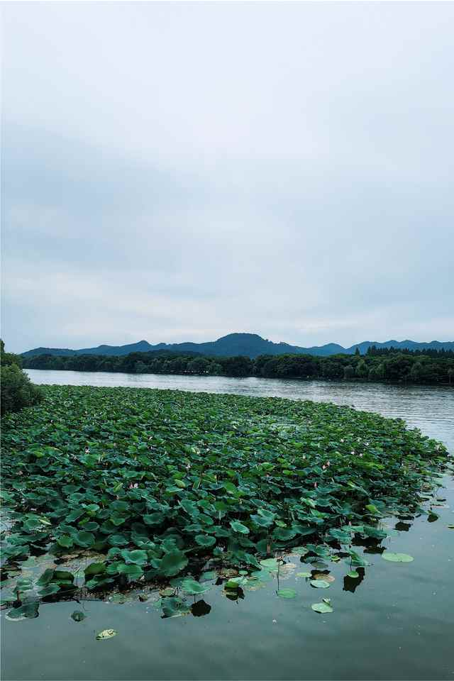

## 远山长，云山乱，晓山青

> “但远山长，云山乱，晓山青。”
> ——苏轼《行香子·过七里濑》

*2023年7月2日，摄于西湖孤山 · 华为 P60 Pro*

从1073年到2023年，千百年岁，如果说什么是不变的，那便是青山了。

彼时的我初初结束人生的一个重大课题——高考，来到西湖边。那一刻，我看到了当年苏轼面对富春江时一样的场景：远山绵延不断，在迷蒙间连向天边，云水一色，乱云重叠，似是天山，近处的山树青翠，绿意盎然。

远山总是难以触碰的，似乎永远没有边界，就像山水画里的墨色落于生宣，慢慢浸染开去。云，它并不像山一样不变，而是瞬息万变的，二者相照，就像苏轼在《前赤壁赋》里所写的，“盖将自其变者而观之，则天地曾不能以一瞬；自其不变者而观之，则物与我皆无尽也。”树总是生长着的，一寸又一寸，欲写着年岁。于是自然在此，人心在此，皆为永恒也不是永恒。只有将心放平，享受当下景。

“君臣一梦，今古空名。”果不其然，而今我看到的，只有“远山长，云山乱，晓山青。”宽阔的，不仅是青山绿水，更是那一片心。
