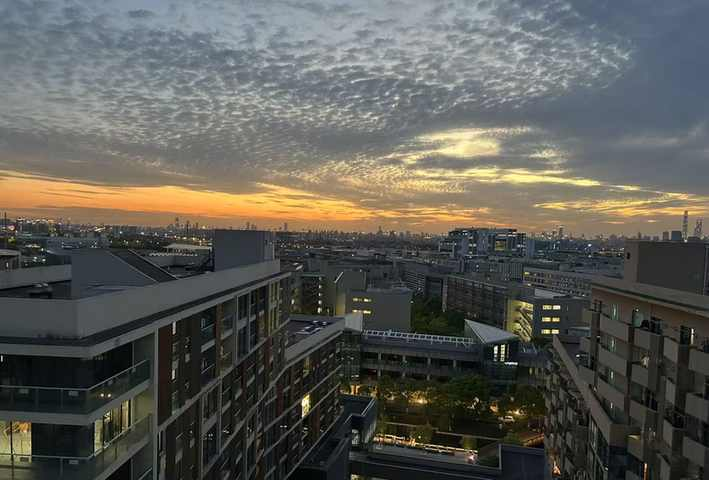

# 镜头

*拍摄信息：2025 年 4 月 · 上海科技大学 · iPhone*

# 配词

> 落日熔金，暮云合璧，人在何处。
> ——李清照《永遇乐·落日熔金》

# 随笔

夕阳将炽热的金色光芒毫无保留地倾洒向天空。浓烈的光辉恰似“落日熔金”，太阳仿佛化作巨大的炼金炉，将天际染成耀眼金黄。每一缕光线都带着即将谢幕的壮烈，又无比灿烂，为城市轮廓勾勒出华丽的金边。

云朵层层堆叠、相互交织，在天空缓缓铺陈并逐渐融合，宛如温润玉璧彼此拼接，诠释着“暮云合璧”的意境。这一刻的黄昏，像是大自然精心雕琢的作品。

“人在何处”既可以是对物理空间的迷茫，也可以是对生命意义的叩问。在永恒自然前，人如沧海一粟。“落日熔金，暮云合璧”是眼前美景，“人在何处”则转向内心探寻；景与问交织，使人也在黄昏光影中思索自己的位置与心灵归处。
