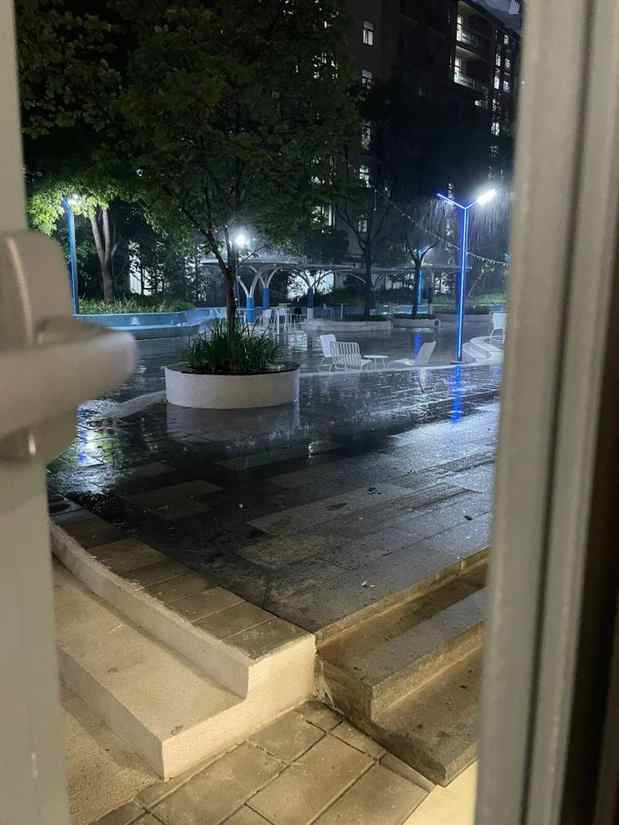

# 镜头

*拍摄信息：2024 年 6 月 23 日 · 上海科技大学 10 号楼活动室 · 手机拍摄*

# 配词

> 寒蝉凄切，对长亭晚，骤雨初歇。
> ——柳永《雨霖铃·寒蝉凄切》

# 随笔

拍下这张照片时，我正在通宵赶作业和期末项目。窗外忽然下起雨，原本积压在心里的疲惫与凄凉也被雨声唤醒，因此想到柳永《雨霖铃》的开篇。

词中写离别时的寒蝉、长亭与骤雨，外在天气不是愁绪本身，却为难以排解的感情提供了声音与形状。后文“此去经年，应是良辰好景虚设”进一步说明：即使未来遇见好天气，内心的烦闷也不会立刻消失。

我的雨夜当然不同于柳永的离别，但雨在两种处境里都像一个开关。即使没有这场雨，疲惫依旧存在；雨只是让它突然变得可以看见、可以描述。
