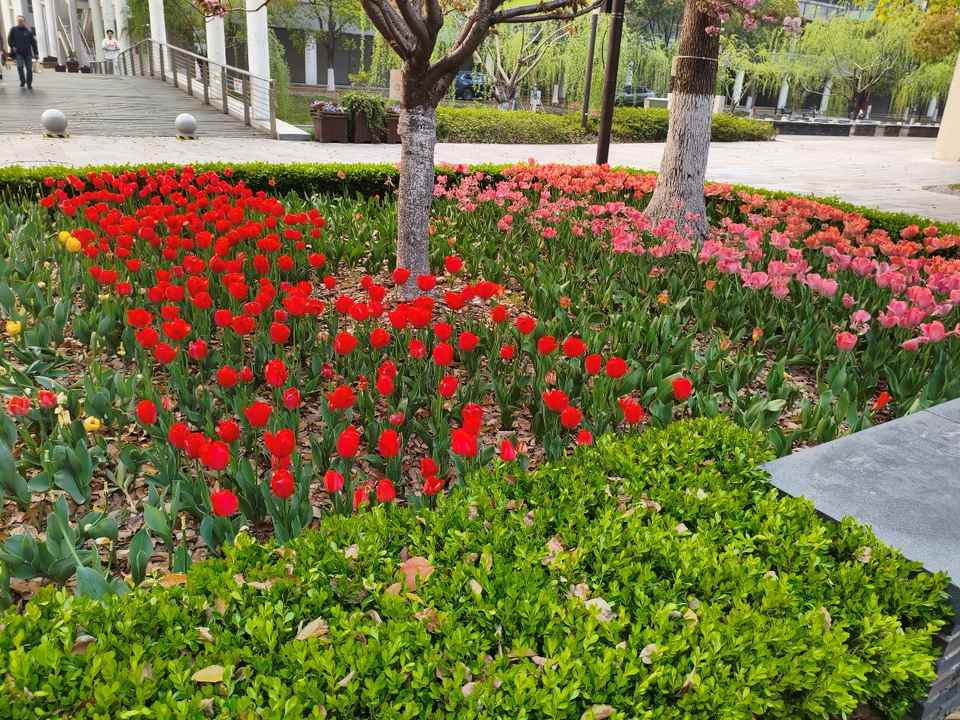
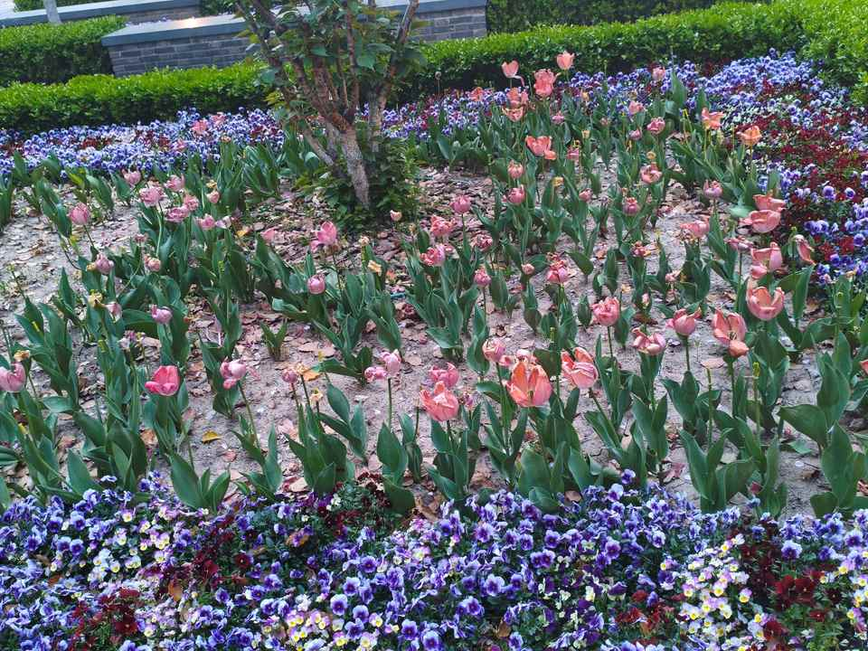

> 2025 年 4 月 5 日午，上海科技大学
>
> 设备：REDMI Turbo 4

> 2025 年 4 月 9 日午，上海科技大学
>
> 设备：REDMI Turbo 4

## 欧阳修《减字木兰花·留春不住》

> 留春不住，燕老莺慵无觅处。说似残春，一老应无却少人。
>
> 风和月好，办得黄金须买笑。爱惜芳时，莫待无花空折枝。

## 配词随笔

平常的一日，在这片日日经过的花坛前，我不禁缓缓驻足，望着眼前一朵朵郁金香，我感到陌生而欣喜——这是我第一次注意到它们。但课程繁忙，我无法细细观赏，只得无奈离开，将其逐渐遗忘。然而，短短四日后，当我再次忆起这片春天的象征，却发现它们大多已经衰败凋零。零星几朵只剩下卷曲衰败的瓣边，而更多的则只剩下枝叶孤立，似风中残烛，倔强却无力。

我脑中不由得浮现那句：“留春不住。”简单四字，却重若千钧。留不住的，不只是花，更是春天本身。在欧公笔下，春日的流逝，是寻不见慵懒疲惫的莺莺燕燕，而眼前这一幕，与其并无二致：曾经的盛放终究抵不过季节的更迭，曾经的生机也终究抵不过时光的流逝。

在两张图像之间，我仿佛看见春天的消逝，那不是喧哗的告别，而是安静的转身。前日的花朵正值盛年，令路人无不驻足凝视；而后日之景，却只剩残红零落，无声无息。仿佛刚散的宴席，空气中尚存余温，喧哗嬉戏却已然不在。我不禁叹息，更怀念、懊悔，没能珍惜这片短暂而绚丽的花圃。这不仅是对花谢的哀伤，更是一声对岁月流逝的悲叹。春天的离去，不在一瞬，却又能在悄无声息间使生机勃勃的景象迅速消散，正如那盛放的郁金香，仅短短四日便无声凋零，又如同人之老去，往往不在朝夕之间，却又突然在转身时，发觉自己已经不复昨日神采。

“爱惜芳时，莫待无花空折枝”。花的谢幕，不是消逝的悲哀，而是完成一段旅途后的归去。我们之所以伤感，不过是因为未能及时将那一刻的美好珍藏。欧公的劝诫像春风般，温柔却警醒。面对这变幻无常的世事，我们总是在时过境迁后方觉悔恨，恨在花开时未曾驻足欣赏，恨在风来时未曾张开双臂。倘若我们能够在那美好的时刻及时行乐，想必即便未来想起，心中更多的也会是喜悦，而非遗憾吧。

今日，我望着这片已经悉数凋谢的郁金香，虽为逝去惋惜，却更应学着接受和铭记。这短暂的花期，这寂静的凋零，正是春天最深处的回响。春，终不可留，但若能及时享受，“携手玩芳丛”，在我们心中留一片曾经盛开的记忆，这又何尝不是春天留给我们的礼物。

## 参考书目

欧阳修著、李逸安点校：《欧阳修全集》，中华书局，2001 年 3 月第一版，第 1999、2051 页。
