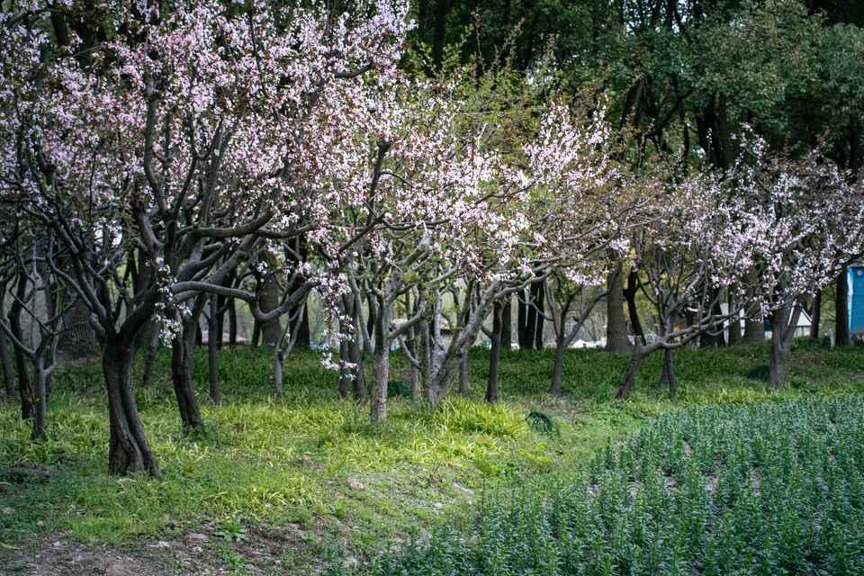

> 2024 年 3 月 23 日，世纪公园
>
> Canon EOS 850D，f/5，1/160 s，ISO 2000，38 mm

## 欧阳修《浪淘沙·把酒祝东风》

> 把酒祝东风，且共从容。
> 垂杨紫陌洛城东。
> 总是当年携手处，游遍芳丛。
>
> 聚散苦匆匆，此恨无穷。
> 今年花胜去年红。
> 可惜明年花更好，知与谁同？

## 配词随笔

在 Lightroom 中回顾去世纪公园踏青的照片，并寻找配词时，再次回顾读过的各位词人的词，发现浏览照片的人可能不太容易把这些照片与一种特定的情感相连接，于是陷入了选词的困难中。进而再次回想世纪公园的周末：暂别各种任务和期限，来到公园里可以看到形形色色的人用不同的方式享受春天，轻松欢快，让人想起琅琊山中或歌于途、或休于树的众人和醉乎其间的庐陵太守。

而《唐宋词十七讲》中评价欧阳修词作有一种“遣玩的兴味”，一如《浪淘沙》一词中的“从容”，是踏青的心情的概括，其中也有“今年花胜去年红”这样对自然与春光的欣喜。但踏青赏春之余，无穷的聚散之恨占据了春景以外的生活。春花年年更好，即使“游遍芳丛”（就像这次春游），但与春天聚散总是匆匆，而生活就是春光外围沿的树丛与草地。
