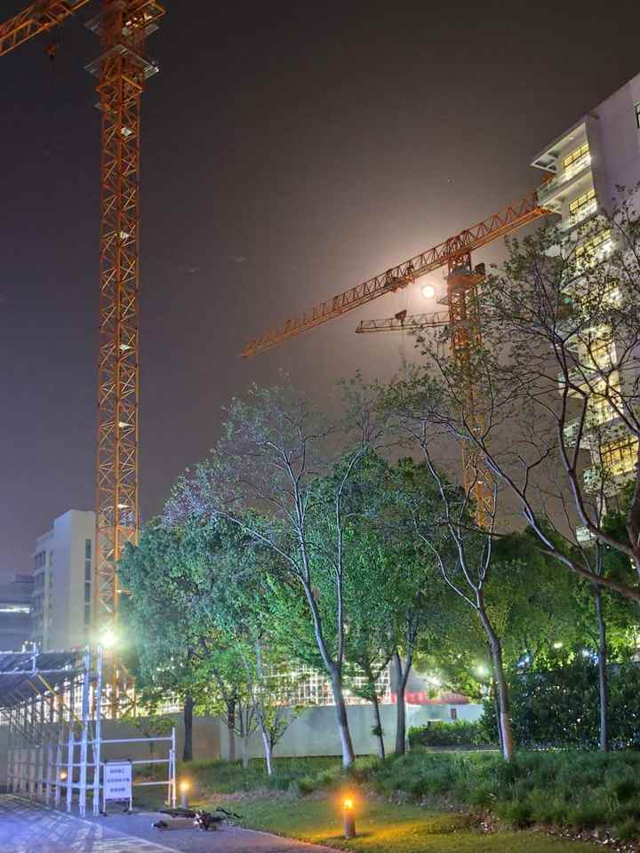

*拍摄设备：红米 Note 13 Pro*

*拍摄时间：2025年4月13日夜*

*拍摄地点：上科大上海银行前的路上*

# 配词

> 宝月圆时多异气。夜光一颗千金贵。

## 蝶恋花·海岱楼玩月作

*宋·米芾*

> 千古涟漪清绝地。海岱楼高，下瞰秦淮尾。水浸碧天天似水。广寒宫阙人间世。
>
> 霭霭春和生海市。鳌戴三山，顷刻随轮至。宝月圆时多异气。夜光一颗千金贵。

# 随笔

## 塔间月

读会儿词书，再看看自己这几个月的相册，大多是门口的工地。工地好看啊，各个角度都透露着力量，拍照都不用思考构图光线，感叹古人见不到现代城市而匮乏了许多奇观。比起自然的那些奇观，我觉得果然还是人造的更有气势。这种不及自然的有限的力量或许更显力量感？

拍学校花花草草的几张，上课路匆匆，现在看来不是糊的就是歪了，救不回来。还好有这月亮千古，能跨越时间，古人爱写，我又正好拍了，能配成一对。

照片拍于2025年4月13日夜，晚上从家回到学校，在东门往宿舍的一段路上。农历十六，月很圆，可能是空气比较湿润，还晕着一圈柔光，好亮好漂亮。那第二天早八是电动力学的期中考试，Full Moon Full Life。可惜当时还是匆匆，摄像是什么夜间模式，没太注意，照片放大看是糊的。

而翻了翻词，发现细写圆月的常与水天联系着，总是壮阔，但不可爱。我寻思我看到这月亮虽有圈光晕，总还是小小的一颗。而米芾这词，初看有点平平无奇，但多读又觉得清澈可爱，感觉姑且算是有点合适吧。尤其是最后“宝珠”的喻，回忆起来，说月亮像珠子的名篇似乎不太多，亮亮的一颗月“球”散着光芒，明明挺贴切的，是没有地圆说的缘故吗？书上还有个配图，也晕了一圈光，不过球更大点。
