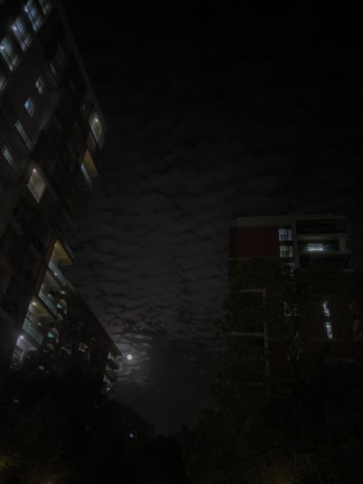

# 镜头

*拍摄信息：11 月 3 日凌晨 1:32 · 上海科技大学 · vivo Y200i*

# 配词

> 别来三度，孤光又满，冷落共谁同醉？
> ——苏轼《永遇乐·长忆别时》

# 随笔

照片的主题虽然是月，最初吸引我的其实还有棉絮一样的云。因此月亮没有落在画面正中：那天从便利店出来，抬头看见云与满月，觉得既可爱又有一点感伤，便拍了下来。

选择这句词，最直接的理由自然是“孤光又满”的满月；而“别来三度”与“冷落共谁同醉”，在我心中也有另一层对应。“三”让我想到大学三年、离家求学的第三年、第三个秋天，也是与高中朋友分赴不同城市后的第三年。

我比词中人幸运得多：有社交媒体与家人朋友通信，也有寒暑假可以回家相聚。但在浸着凉意、独自学习、备考并思索未来的凌晨，仍难免生出“冷落”之感。

苏轼与友人分别多年后，在日常中见到这一轮圆月而写下《永遇乐》。他抬头的那个瞬间，是否也与我按下快门时有一点相似？
