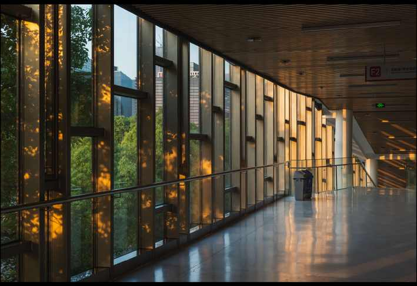

# 镜头

*拍摄信息：学生活动中心二楼 · NIKON Z 5，50 mm，f/8，1/15 s，ISO 250*

# 配词

> 夕阳西下几时回？
> ——晏殊《浣溪沙·一曲新词酒一杯》

# 随笔

平凡的一天，在咖啡馆学习得有些疲累，于是带上相机在校园走走，拍下透过玻璃窗洒入的粼粼夕阳。熟悉的校园一角、日复一日的夕照，对咖啡馆常客而言再普通不过；可真正遇见这一刻时，我却希望短暂的金黄能够停留，时光不再流逝。按下快门，便是最直接的保存方式。

“夕阳西下几时回？”夕阳落下后仍会再次升起，可过去的时光与人事却无法重新追寻。快门可以让光影凝固，时间仍会从指尖流过。我们能够做的，是继续发现、体验并珍惜身边美好的事物。
