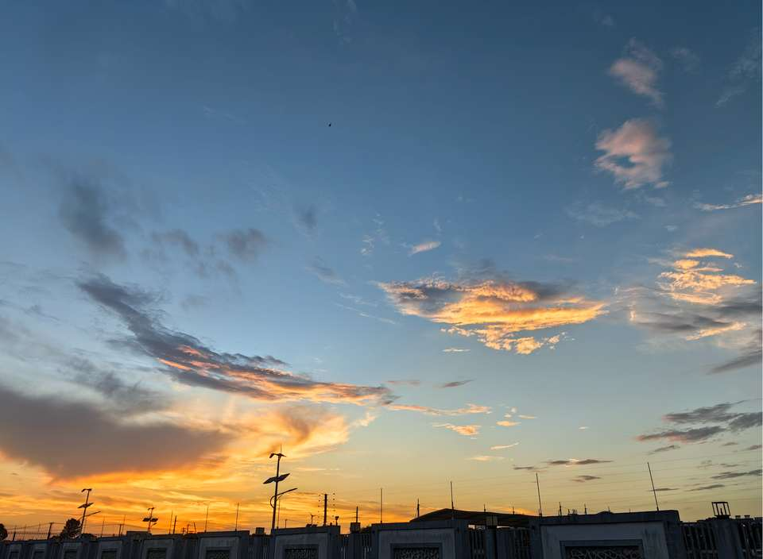

## 落日熔金，暮云合璧

> “落日熔金，暮云合璧，人在何处？”
> ——李清照《永遇乐》

*2026年4月5日，摄于苏州市吴江区 · 华为 P60 Pro*

落霞的美，真的永远称得上惊艳，而且，日日不同，时时不同。

高中晚自习的时候，能够透过窗，看到落日余晖，自从上了大学，也没了饭后散步的习惯，总是错过落日，所以每次看到，都会很珍惜地记录下来。

“落日熔金”，我想不出更好的句子能超越这句词。只用了“熔金”二字。就把落日的灿烂、流光溢彩刻写得淋漓尽致，璀璨而夺目。落日余晖是金色的，是流动的，浓烈艳丽。

“暮云合璧，人在何处？”余晖是恢弘的，而恢弘之下，总是容易引起对天地浩渺的深思。越站在天地宽广之下，越觉得人渺小，越想起从前画面。日暮天生对人有一种惆怅的吸引，一天即将结束，在最后的绚丽里，人们惊叹又沉思，随同念头一起渐渐沉入黄昏夜色中。
