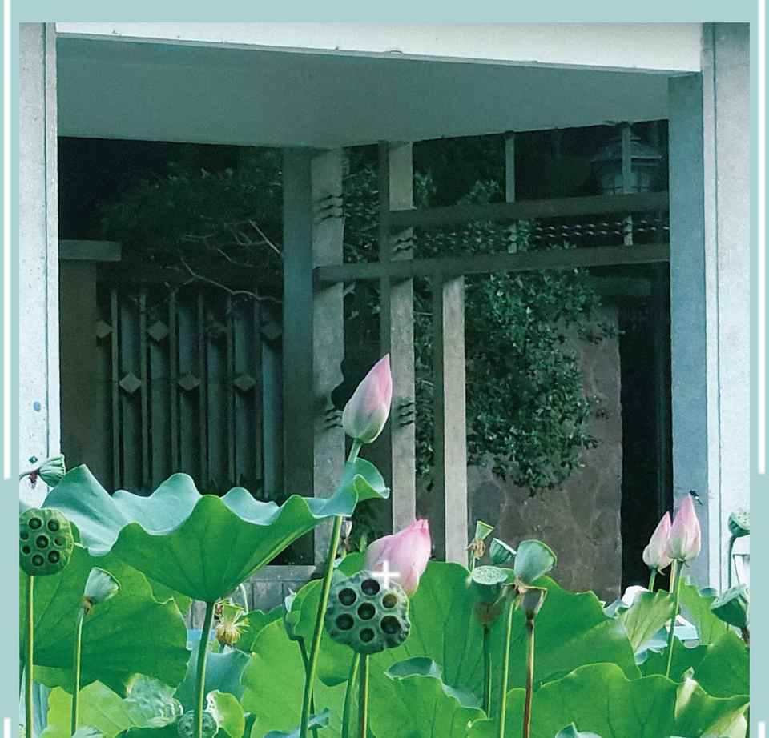

## 晏殊《渔家傲·荷叶初开犹半卷》

> 荷叶初开犹半卷，荷花欲拆犹微绽。
> 此叶此花真可羡。
> 秋水畔，青凉伞映红妆面。
>
> 美酒一杯留客宴，拈花摘叶情无限。
> 争奈世人多聚散。
> 频祝愿，如花似叶长相见。

## 配词随笔

荷花对我有特殊的意义。

我出生于济南，一个以泉水与荷花闻名的城市。大明湖畔的荷花，便是我故乡的浓缩。

其他的花都是要绿叶衬，但荷花不同：荷花或者荷叶单独出现时，它们看起来平凡无趣；但当它们一起出现，连成一片时，那种温润和静谧，才最打动人心。

荷田，荷田，荷花该是一片一望无际的田野，像大明湖畔那样，遮盖住湖岸的曲折。

可自从我离开济南，我再也没见过这样的荷田。

直到那天。

我已经不记得这张照片是在哪里拍摄的了，我只记得当我误打误撞走进那个公园，拐过那个转弯，走过曲折的连廊——有那样大一片荷田，直白却安静地，那样铺开在我的眼前。荷花与荷叶，层层叠叠，繁繁复复，紧密地依偎在一起。

> 此叶此花真可羡。

但我远在千山之外，和我的故乡遥遥相望。有那么一瞬间我想直接穿越回我的家里，我想窝在温暖而柔软的沙发上，抚摸我的猫咪，和家人闲谈。

> 争奈世人多离散。

与故乡相隔千山万水，怎么不算是一种离散。

只是愿你我，愿世界上所有的人：

> 如花似叶长相见。
