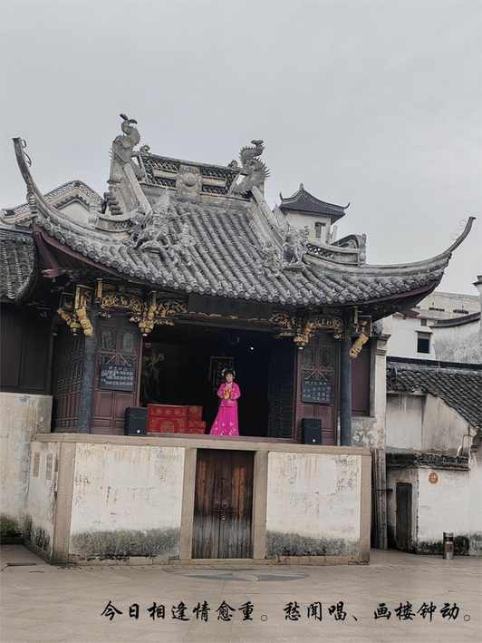

# 镜头

*拍摄信息：2024 年 4 月 4 日 10:17 · 浙江乌镇 · HONOR 80*

# 配词

> 忆昔西都欢纵。自别后、有谁能共。
> 伊川山水洛川花，细寻思、旧游如梦。
> 今日相逢情愈重。愁闻唱、画楼钟动。
> 白发天涯逢此景，倒金尊。殢谁相送。
> ——欧阳修《夜行船·忆昔西都欢纵》

# 随笔

这首词写昔时故都欢纵，尚无忧虑；而今重游，再见此山、此水、此楼、此曲，不觉触景生情，怅然而愁。

照片摄于江南水乡乌镇。行至水穷处，忽现一楼一戏台，悠悠的唱词萦绕耳畔。飞檐斗拱与古旧唱台，正像儿时随外婆看戏的景象。只是时过境迁，在高压的学习与现代城市里，早已少见那般古旧淳朴的唱台，也少有在山野水乡闲看唱段的情致。

今日不期重闻旧音，只觉唱得格外亲切，正是“今日相逢情愈重，愁闻唱、画楼钟动”。欧公忆“西都欢纵”，而我忆阔别十年的孩提时光，也生出“细寻思、旧游如梦”的感慨。
