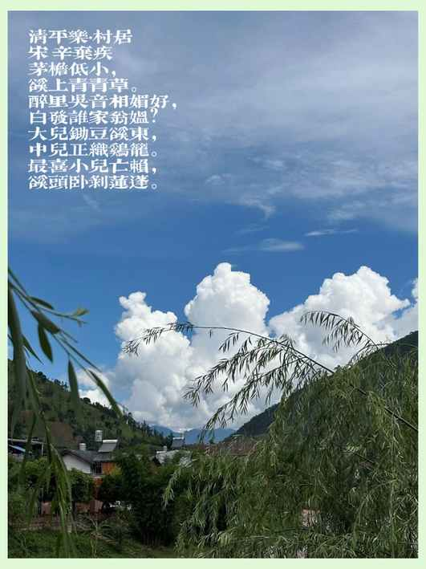

# 镜头

# 配词

> 茅檐低小，溪上青青草。醉里吴音相媚好，白发谁家翁媪？
> 大儿锄豆溪东，中儿正织鸡笼。最喜小儿亡赖，溪头卧剥莲蓬。
> ——辛弃疾《清平乐·村居》

# 随笔

这张照片拍摄于一次乡村社会实践。那是笔者第一次真正深入乡村、深入自然：湛蓝的天、闪烁的星、朴素的乡音，以及在小路上微笑着相互招呼的人们，都让照片中的“村居”有了切身的温度。

“村居”之所以成为“村居”，关键还在一个“居”字。短暂经过只能看见风景，长一些的停留才会真正融入生活。实践的日子并不算久，却让人感到一种平淡、长久而温和的快乐。这也是笔者从《清平乐·村居》中读到的快乐。
