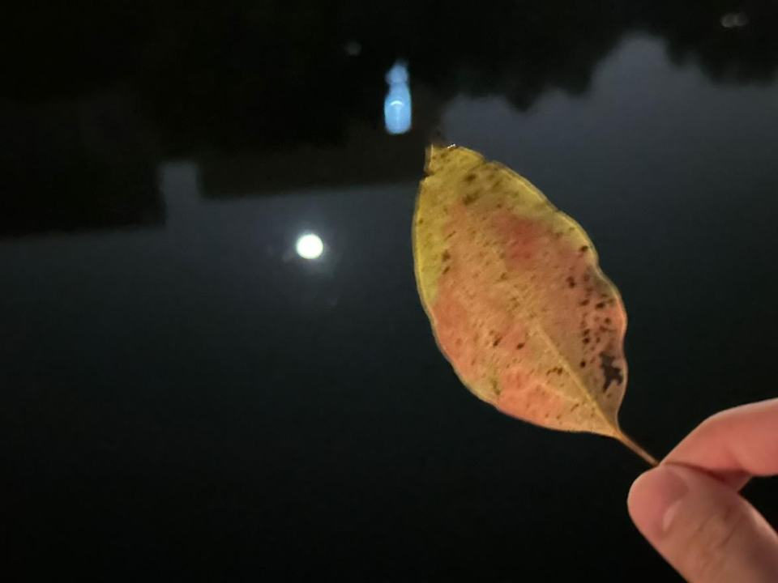
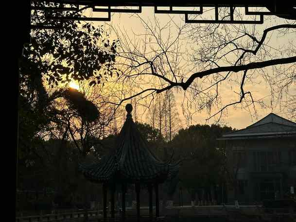

*图一：2024年11月13日00:42 · 上海科技大学校史馆前水池*

*图二：2024年1月26日16:26 · 苏州中学仰高亭*

# 自填词

## 浣溪沙·秋夜

> 脉脉月华谴谁藏，小池收尽秋夜凉，舀作清涟碎玉妆。
>
> 琉璃曲径清风淡，乌丝阑干蔓草扬，秋蝉何苦掩幽肠。

# 赏析

这是一首描绘深秋夜景的小令。词以清晰的意象、细腻的笔触与内蕴的感情，将读者带入一个静谧深沉的秋夜画卷。

首句“脉脉月华谴谁藏”，作者似乎在举头望月，其中“脉脉”一词赋予了月光以柔情，仿佛责问深情予谁，还未展开描写就已表达出思念的忧愁。次句“小池收尽秋夜凉”画面转换，实际上作者是在看水中之月，小池映着月色，承载了一整夜的寒凉，似乎秋夜的清韵都归藏于池水。末句“舀作清涟碎玉妆”再度将视角收紧，着眼于手中舀取的清涟，涟波中的月光如同碎玉一般美好，但又无法留存。上片一气贯注，着眼于作者在池边赏月的景象。

下片写“琉璃曲径清风淡，乌丝阑干蔓草扬”，转眼于词人所坐之处是园林中的阑干曲径，清风吹拂，蔓草摇动，给人一种清新而又惆怅的感觉，增添了秋夜中的孤寂和萧索。全词末句“秋蝉何苦掩幽肠”，作者被全词唯一出现的声音所吸引，以秋蝉的鸣叫映射出词人心中的孤独，似乎在自问为何如此苦涩，从而暗暗表达出内心深处的郁积。

整首词以秋夜为背景，巧妙地运用月光、池水、清风、栏杆、蔓草、秋蝉等意象构成饱含思念气氛的意象群，构建出一个既凄清又宁静的画面，阅读时代入情景可以感受到一种淡淡的忧愁与空寂。词人通过这些自然景物的描绘，传达了秋天特有的凄凉美感和对那个人的思念。虽然词中没有直接抒发个人情感，但从对自然的描绘中，读者可以饱览词人内心深处的情感流露，触动人心。

词的语言清丽，意境优美。全词没有刻意抒情，而是通过对秋夜微妙的观察与情感的渗入淡淡表达，给人以深沉静谧之感。不仅传递了深秋之夜的宁静凄迷，更展示了词人内心的情感世界。
