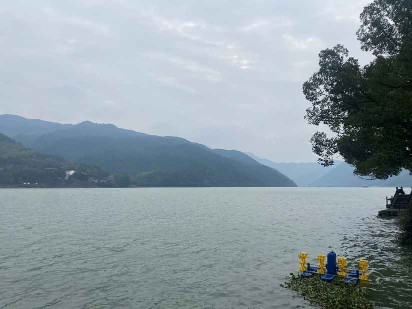
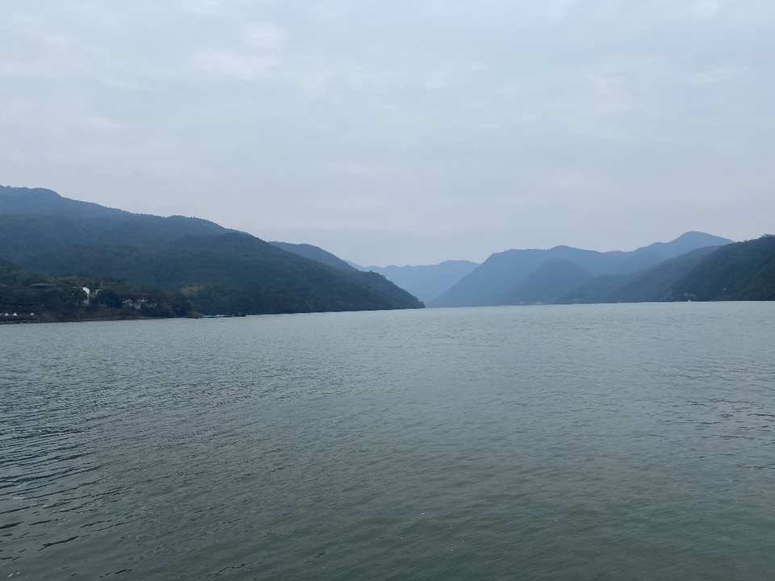

*拍摄时间：2023年12月17日*

*拍摄设备：iPhone 11*

癸卯冬，前往富春江桐庐段寻找诗歌中的美景。

# 配词

## 行香子·过七里濑

*宋·苏轼*

> 一叶舟轻，双桨鸿惊。水天清、影湛波平。鱼翻藻鉴，鹭点烟汀。过沙溪急，霜溪冷，月溪明。
>
> 重重似画，曲曲如屏。算当年、虚老严陵。君臣一梦，今古空名。但远山长，云山乱，晓山青。

# 随笔

时值严冬，所遇之景与苏东坡词中景象已有所不同：若以词入画，则“重重似画，曲曲如屏”“远山长，云山乱，晓山青”等参与构图的标志性景象未改变，而“水天清、影湛波平。鱼翻藻鉴，鹭点烟汀”、前人“风烟俱净，天山共色”“水皆缥碧，千丈见底”等细节已发生改变；古今萧条异代，“一叶舟轻，双桨鸿惊”等景象已不再，只有现代的大船留下一道长长的波痕。

富春江两岸高山夹江，颇有三峡之美，然而独属江南的自然人文韵味赋予了这里不同于三峡“巴东三峡巫峡长，猿鸣三声泪沾裳”“听猿实下三声泪”“江间波浪兼天涌，塞上风云接地阴”的悲壮之感。究其原因，三峡景壮，其中又有滟滪堆之类凶险恶煞之景，多羁旅之客，而富春江山水更秀，所处之人多望峰息心，隐居于此。

照片被三部分占据：天、江、山。其中因为时节原因，天空多云，其中略透日光，似浓厚涂抹的画；水澄而不澈，可见翻波。山则最具苏词中景：富春江蜿蜒连绵，两岸皆有山，而水与天更显山色，故远处山峦隐约重叠，正应“重重似画，曲曲如屏”。山上隐居严子陵则印证后面部分“算当年、虚老严陵。君臣一梦，今古空名”。时节原因未见山头白云，然而空中云海连绵，也可看作是“云山”。

其景又合两则山水小品文《答谢中书书》及《与朱元思书》；其中后者已点出所描绘者乃是“自富阳至桐庐一百许里”，不再多言。前者“青林翠竹，四时具备”也为实情；登至山顶亭台，亦可听见鸟儿争鸣，加上人声，可以理解为“猿鸟乱鸣”。

此外山中亦有衰败黄叶，时值冬日不禁想起“当时宋玉悲感，向此临水与登山”。江南建筑白砖黑瓦，湖面澄澈如鉴；加之远峰连绵，亦有诗意。
