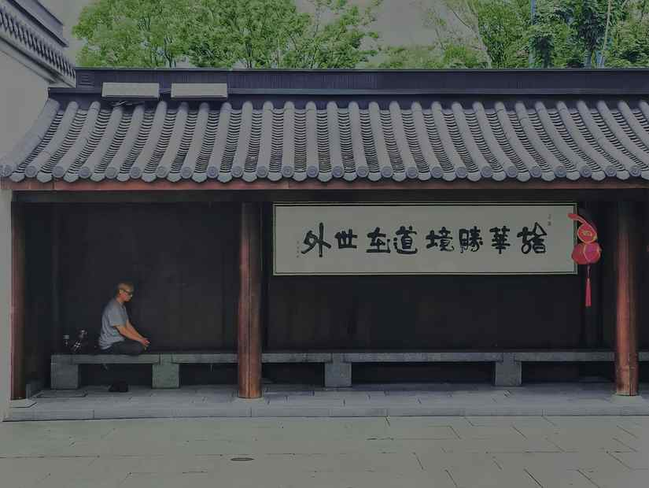

*作品名：《禅》 · 拍摄地点：徐汇区龙华寺 · 拍摄时间：2023年6月25日13:52*

# 照片解读

这张照片来源于我在游览龙华寺时偶遇的一位中年男子。

和其他来参观庙宇的游客或潜心朝拜的香客不同，他一个人在环绕寺庙的中式回廊的阴影里坐了很久。也不与人交谈，也不自娱自乐，只是安静地闭着眼打坐，好像完全屏蔽了旁人的吵闹。

很有意思的是，回廊的背板上挂着一块白底匾额，上面用黑色汉字书写着“龙华胜境，道在世外”，似乎也在暗示着这里超脱世俗的氛围，与他所处的状态完全一致。

和景点全貌相比，这个画面给我一种宁静的感觉。他像是不属于这里的事物，又或是早已超越了这里，突兀，但又自成一体。

# 配词

## 临江仙·赠王友道

*宋·苏轼*

> 谁道东阳都瘦损，凝然点漆精神。瑶林终自隔风尘。试看披鹤氅，仍是谪仙人。
>
> 省可清言挥玉尘，真须保器全真。风流何似道家纯。不应同蜀客，惟爱卓文君。

# 词句分析

译文：琼林般的仙境终究远离尘世。试看你披着鹤毛制作的斗篷，依然像谪到人间的神仙。

苏轼在这里进一步赞颂友道高洁超尘的风姿：一尘不染，与世无争。这里连用三典。王戎之典，喻示友道“风尘外物”、有“琼林”般的神姿；王恭之典，喻示友道“披鹤氅裘”、洁如鹤羽的“真神仙人”气质；李白之典，喻示友道从仙界贬到人间，成为尘世不可企及的道人。以典赞美友道“凝然有神，风姿绰绰，宛如‘神仙中人’”，恰到好处。

# 配词缘起

之所以选择这句词，是因为它完美符合我对这名中年男子身份的想象——谪仙人。衣着朴素，行囊简单，不像是来游乐，反倒像是在修行。他沉浸在自己的世界里，坚定地追求着他的目标。这种和周遭格格不入的行为，又恰好发生在寺庙内、匾额旁，很难不让人联想到一个被贬落人间的神仙。因不愿沾染世俗的污垢，他每日前来寺庙中打坐修行，通过闭目的方式守住内心的纯净。

他所向往的境界终究和尘世相隔甚远，但只要得到了些许点悟，找回了曾经的逍遥姿态，他还是那个仙人，不过是暂住人间罢了。

对于这名男子的更多细节我无从得知，他经历了什么、思考着什么我也难以理解。不过能够在生活里见识到这样一位“仙气飘飘”的人，窥探到一点佛教中“超然物外”的精神，我很荣幸，也知足了。
